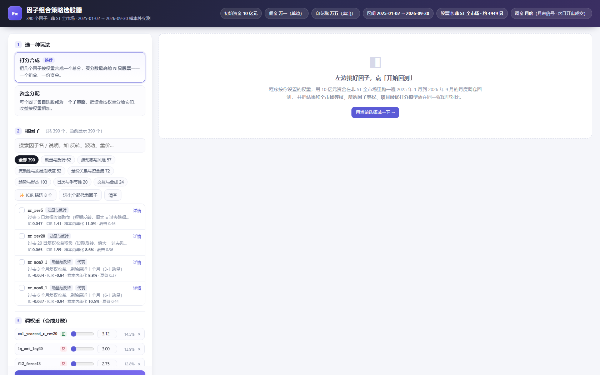
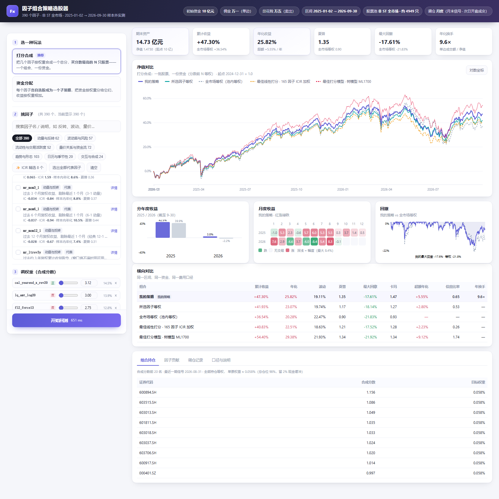
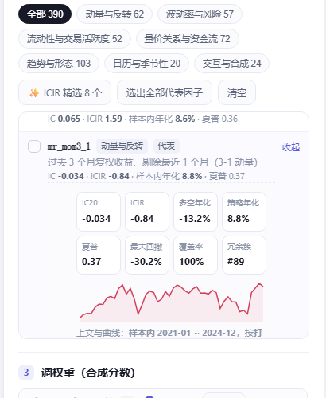
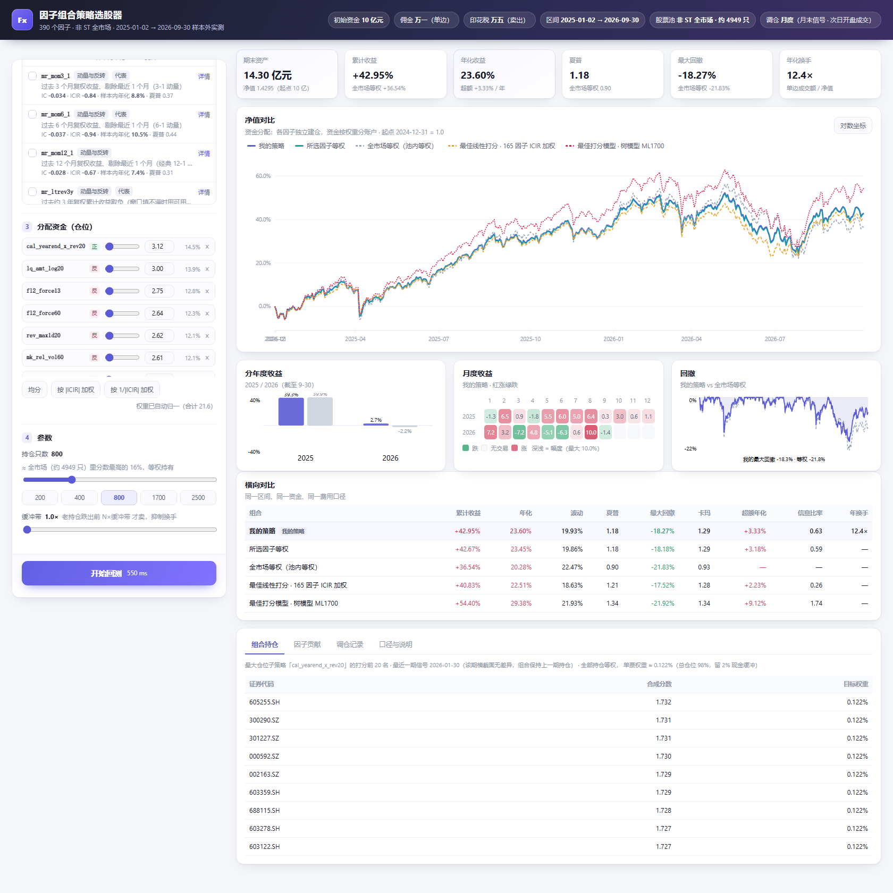

# Class4 回测 · 全流程量化项目

「当代量化交易系统原理与实现」第四节。**三项工作 + 一份独立核验 + 一个交互式策略选股器 WebUI**，
每项工作一个文件夹，每项工作有自己的 README；所有产物统一在 `out/<工作名>/` 下。

仓库：<https://github.com/Mai-Xu/Class4_Backtest>（`feathers/` 不进库，约 226 MB）

## 界面预览 · 策略选股器

`04_策略选股器/` 是一个本地 WebUI：左边挑因子、拉权重，点一次「开始回测」，右边给出 10 亿元资金
在 2025-01-02 → 2026-09-30 的实测结果，并与全市场等权、所选因子等权、项目最优打分模型画在同一张图里。

| 挑因子 · 调权重 | 回测结果（净值对比 + 绩效 + 持仓） |
| --- | --- |
|  |  |

| 因子详情：简介 + 样本内表现（截止 2024 年底） | 资金分配模式：各因子独立建仓、按权重分账户 |
| --- | --- |
|  |  |

> 更多截图（悬停对比、调仓记录、口径说明）在 `out/04_策略选股器/figures/`。

## 目录地图

```
Class4_回测/
├── README.md                 ← 本文件：目录地图 + 结论
├── 核验报告.md               ← 对全部交付物另写一套实现的独立核验（谁做的/怎么验/结论）
│
├── 01_数据核验/              ① 这份数据对不对？
│   ├── s01_audit.py            内部一致 + 数据体检
│   ├── s02_external_check.py   与外部行情逐格比对（联网）
│   ├── 复核/                   另写一套实现的独立复核（脚本 + 证据 + 报告）
│   └── README.md
│
├── 02_回测系统/              ② 引擎像不像实盘？单因子策略赚不赚？
│   ├── s02_backtest.py         5 个主策略 + 12 组口径对照（不复权/忽略涨跌停/…）
│   ├── s03_report.py           报告 + 自包含看板
│   ├── s04_vol_volume.py       波动率 + 成交量 13 因子策略
│   ├── s05_robustness.py       19 组参数扰动 / 成本盈亏平衡 / 随机对照 / 引擎不变量
│   ├── s06_report.py           看板
│   └── README.md               含复权记账、涨跌停方向性、T+1/容量、API 速查
│
├── 03_因子挖掘/              ③ 390 个因子怎么变成能下单的组合？（含多因子打分选股程序）
│   ├── 因子模块开发规范.md      subagent 写因子的接口契约（数据字典 / 硬性规则 / 逐模块清单）
│   ├── run_all.py              一键跑完整条流水线
│   ├── s20_zoo_check.py        因子库质量门：形状 / 覆盖率 / 因果性
│   ├── s21_factor_eval.py      IC / ICIR / 衰减 / 分层 / 相关性 / 冗余聚类  ← 2021-2024 定方向，2025-2026 检验
│   ├── s22_export_panels.py    导出因子字典 + 面板清单（给下游打分程序）
│   ├── s23_multifactor_bt.py   多因子打分选股 + 指定口径回测
│   ├── s24_report.py           报告 + 自包含看板
│   ├── s25_robustness.py       参数 / 成本 / 家族留一 / 随机对照
│   ├── s26_ml_score.py         机器学习打分对照（树模型，严格样本外）
│   └── 复核/                   独立复核（回测记账 + 因子因果性两套）
│
├── 04_策略选股器/            ★ 交互式 WebUI：挑因子 → 调权重 → 10 亿资金实测（两种玩法）
│   ├── build_ui_data.py        预计算 UI 数据（秩 z 面板 / 因子历史表现 / 基准曲线）
│   ├── fastsim.py              与引擎对拍的快速回测口径（向量化，单次 < 1 秒）
│   ├── app.py                  Flask 服务 + JSON API
│   ├── verify_vs_engine.py     与 core.engine 逐日对拍（日收益相关 ≥ 0.9987）
│   ├── web/                    前端（原生 HTML/CSS/JS + 手写 SVG 图表，离线可用）
│   └── README.md               接口 / 口径 / 偏差 / 限制
│
├── core/                    共享库：数据层 / 回测引擎 / 策略基类 / 内置因子 / 绩效
├── factor_zoo/              390 个因子（15 个模块 / 7 大家族）+ 因果性校验器 + 面板缓存 + 下游 API
├── tests/                   101 项单元测试（数据层 29 + 引擎 25 + 因子 21 + 选股器 26）
├── feathers/                原始行情：7 个日频矩阵（226 MB，不入库）
│
└── out/                     全部产物，按工作分目录
    ├── 01_数据核验/           data_audit.md / external_check.md / figures / tables
    ├── 02_回测系统/           backtest_report.md / vol_report.md / 看板 / figures / tables / runs
    ├── 03_因子挖掘/           mining_report.md / dashboard.html / tables / runs
    ├── 04_策略选股器/         figures/（WebUI 截图）/ tables/（引擎对拍结果）
    ├── cache/                因子面板缓存 / selector 选股器物化数据（可再生、不入库）
    └── README.md             产物索引
```

## 三项工作分别在问什么（＋一个可交互的选股器）

| # | 目录 | 回答的问题 | 一句话结论 |
| --- | --- | --- | --- |
| ① | `01_数据核验/` | 这份数据**对不对**？ | 不复权 OHLC 与外部行情**逐格完全一致（78,264 格 0 差异）**；成交额经 VWAP 约束 0 越界。数据可信。 |
| ② | `02_回测系统/` | 引擎**像不像实盘**？单因子赚不赚？ | 无摩擦等权全市场与理论等权收益**相关系数 0.9963**；忽略涨跌停平均高估 0.42 pp/年，忽略复权平均低估 2.9 pp/年；成本盈亏平衡点 3.45 倍。 |
| ③ | `03_因子挖掘/` | 390 个因子里哪些有信息？怎么变成**能下单**的组合？ | 复合打分样本外五分位 Q1 +3.9% → Q5 +22.3%（Q5−Q1 **+18.4pp**）；多头端 α 主要来自**剔除最差尾部**，故用「打分前 40%（≈1700 只）等权」：线性 ICIR 加权年化 **22.51%**（夏普 1.21、超额 +2.23pp），树模型打分年化 **29.38%**（夏普 **1.34**、超额 **+9.10pp**、IR **1.73**）。 |
| ★ | `04_策略选股器/` | 想自己挑因子、拉权重看结果，怎么办？ | 本地 WebUI：选因子 + 调权重 → 打分合成（一个组合）或资金分配（多子账户），点一次出结果；同图对比**全市场等权 / 所选因子等权 / 项目最佳线性打分 / 最佳树模型打分**。快速口径与引擎对拍日收益相关 ≥ 0.9987、年化偏高 0.13~0.31pp。 |

## 数据准备（`feathers/` 不进仓库）

原始行情约 **226 MB**，仓库不包含。请把 7 个日频 Feather 放到 `feathers/`（或任意位置后指过来）：

```text
feathers/
├── open.feather  high.feather  low.feather  close.feather   # 未复权 OHLC（元）
├── amt.feather            # 成交额（元）
├── num_trades.feather     # 成交笔数
└── cumadj.feather         # 累计复权因子：复权价 = 原始价 × cumadj
```

2020-01-02 ~ 2026-10-16，1643 个交易日 × 5451 只证券。字段口径与放置方式见 **[`feathers/README.md`](feathers/README.md)**。

三种指向方式（优先级从高到低）：

1. **命令行**：`python 03_因子挖掘/s21_factor_eval.py --data-dir "D:/quant/feathers"`
2. **环境变量**：`CLASS4_DATA_DIR`（或 `FEATHERS_DIR`）
3. **自动搜索**：项目根 `feathers/` → 当前工作目录 → 逐级向上找 `close.feather`

所有脚本统一走 `core/lib.py::resolve_dir()`，**代码里没有任何本机绝对路径**；
报告/日志里的路径由 `core.lib.portable_path()` 输出为相对路径。

## 快速开始

所有脚本都从**项目根目录**运行（脚本内部自带 `sys.path` 引导，在任意 cwd 也能跑），
产物自动落到 `out/<对应工作>/`。

```bash
# 测试（104 项，约 30 秒）
python -m unittest discover -s tests -v

# ① 数据核验（s02 需要联网）
python 01_数据核验/s01_audit.py
python 01_数据核验/s02_external_check.py

# ② 回测系统
python 02_回测系统/s02_backtest.py
python 02_回测系统/s03_report.py
python 02_回测系统/s04_vol_volume.py
python 02_回测系统/s05_robustness.py
python 02_回测系统/s06_report.py

# ③ 因子挖掘 + 多因子打分选股（全流程约 20 分钟）
python 03_因子挖掘/run_all.py --workers 8
# 或分步：
python 03_因子挖掘/s20_zoo_check.py
python 03_因子挖掘/s21_factor_eval.py --workers 8
python 03_因子挖掘/s22_export_panels.py --workers 8
python 03_因子挖掘/s23_multifactor_bt.py --workers 8      # 主回测
python 03_因子挖掘/s23_multifactor_bt.py --neutralize-adv # 规模中性化对照
python 03_因子挖掘/s25_robustness.py --workers 8
python 03_因子挖掘/s26_ml_score.py --workers 8   # 机器学习打分（树模型）
python 03_因子挖掘/s24_report.py

# ④ 交互式策略选股器 WebUI（先预计算一次，再起服务）
python 04_策略选股器/build_ui_data.py     # 约 1 分钟，产物在 out/cache/selector/
python 04_策略选股器/app.py               # 打开 http://127.0.0.1:8770
python 04_策略选股器/verify_vs_engine.py  # 快速口径 vs 引擎逐日对拍（可选）
```

依赖：`pandas` / `numpy` / `pyarrow` / `matplotlib` / `scipy`（WebUI 另需 `flask`）。

## 多因子策略的关键结果

口径：非 ST 全市场 · 10 亿元 · 佣金单边万一 · 印花税万五 ·
2025-01-02 开盘建仓 → 2026-09-30 开盘清仓；因子方向与筛选**只用 2021-2024**。

| 组合 | 累计 | 年化 | 夏普 | 最大回撤 | 超额vs池内等权 | IR | 年换手 |
| --- | ---: | ---: | ---: | ---: | ---: | ---: | ---: |
| **ML1700（树模型打分，推荐）** | 54.40% | **29.38%** | **1.34** | −21.92% | **+9.10pp** | **1.73** | 11.2x |
| ML1700 + 10bp 滑点 + 冲击 | 48.98% | 26.66% | 1.22 | −22.22% | +6.38pp | 1.22 | 11.3x |
| **MF1700_raw（线性 ICIR 加权）** | 40.83% | 22.51% | 1.21 | **−17.52%** | +2.23pp | 0.26 | 10.0x |
| MF1700_raw + 10bp 滑点 + 冲击 | 36.49% | 20.26% | 1.09 | −17.95% | −0.02pp | ≈0 | 10.0x |
| MF1700_ns（规模中性化） | 36.66% | 20.35% | 1.11 | **−15.66%** | +0.07pp | 0.01 | 9.9x |
| 基准（池内等权，日频） | 36.54% | 20.28% | 0.90 | −21.83% | — | — | — |
| 随机对照（同池同 N，10 组） | — | 中位 20.95% | 0.97 | −20.2% | — | — | — |

读这四条就够了（细节见 `03_因子挖掘/README.md`）：

1. **信号是真的，但多头端吃不到多少**：复合打分 OOS 五分位单调（Q1 +3.9% → Q5 +22.3%），
   可是打分最高的 2%~5% 与池内等权几乎无差别 —— α 集中在「避开最差的一档」。
   （树模型把非线性/交互吃进去后 OOS IC 0.1185、ICIR 2.98，组合年化 29.38%、IR 1.73。）
2. **所以正确的用法是宽持仓 + 打分倾斜**：N=100 真实回测年化 14.78%，N=800 → 20.55%，
   **N=1700 → 22.51%**；集中 top-100 在 10 亿资金下还会被参与率上限挡掉近一半委托。
3. **执行与成本是主要漏损**：指定费用（万一+万五）只花 0.38%/年，但再加 10bp 滑点 + 冲击
   线性版的超额就从 +2.23pp 变成 −0.02pp（树模型版仍有 +6.38pp），20bp 时线性版超额 −2.21pp。
   换手 10x 是核心暴露。
4. **规模中性化让回撤改善 1.9pp、超额归零**：+2.23pp → +0.07pp，说明收益里仍有一部分是
   小市值/低流动性 beta（与前一轮工作的结论一致）。

## 数据与口径

- 7 个日频 Feather：`open/high/low/close/amt/num_trades/cumadj`，
  1643 个交易日 × 5451 只证券（2020-01-02 ~ 2026-10-16）；数据放置见 [`feathers/README.md`](feathers/README.md)。
- 价格是**未复权**成交价，复权价 = 原始价 × `cumadj`（累乘因子，最大 98 倍）。
- **复权记账**用「复权份额」而不是「原始股数 × 复权价」，否则持仓价值会凭空虚增。
- **涨跌停方向性**：一字涨停禁买、一字跌停禁卖；反向允许（跌停时卖盘堆积，买方反而容易成交）。
- **T+1 / 容量 / 成本**：先卖后买、参与率上限 10% 当日成交额、佣金 + 印花税 + 过户费 + 滑点 + 平方根冲击；
  被挡下的委托**不假装成交**，逐日落库可审计。
- **因子评价用可成交口径**：前视收益 = `ADJ_O[t+1+h]/ADJ_O[t+1]−1`（次日开盘买入、h 日后开盘卖出），
  不是收盘价对收盘价。
- 数据目录解析优先级（`core/lib.py` 的 `resolve_dir`）：
  命令行 `--data-dir` → 环境变量 `CLASS4_DATA_DIR` / `FEATHERS_DIR` → 本项目 `feathers/` →
  当前工作目录 → 逐级向上搜索 `close.feather`。**代码里没有任何本机绝对路径。**

## 已知限制

| 缺失内容 | 影响的环节 |
| --- | --- |
| 成交量、流通股本、总股本 | 真实换手率、市值加权、更准确的容量估计（现有「换手代理」实为成交额代理） |
| 行业分类、指数成分 | 行业中性化、基准对比、指数增强 |
| 每日涨跌停价、ST 标记、停牌公告 | 已用价格反推近似，无法 100% 还原；非 ST 过滤是近似 |
| 无 VWAP、无分钟/逐笔 | 成交价只能用 `open`/`close` 近似，无法模拟盘中排队与部分成交；筹码分布是成交额分箱代理 |
| `num_trades` 最后一日整行为空 | 涉及成交笔数的因子在该日断点（回测区间到 2026-09-30，不受影响） |
| 证券池随时间增长（3,740 → 5,216） | 必须用动态池，固定池有明显前视偏差 |
| 样本外只有 21 个月 | 年化差异的标准误约 ±4pp，不要把 +9.1pp / +2.2pp 超额当精确估计 |
| 年化按 252 交易日折算 | 按自然日折算会低约 1pp（22.51% → 21.53%） |
| 末日仍有 12 只残仓（约 162 万元、0.12% NAV） | 2 只停牌 + 10 只已无行情，无法卖出，已在 `blocks.csv` 列明 |

## 代码结构

| 目录 | 内容 |
| --- | --- |
| `core/lib.py` | 数据层：复权、停牌、一字板、涨跌停、动态股票池、交易日历 |
| `core/engine.py` | 回测引擎：目标权重驱动 + 逐日撮合（T+1 / 涨跌停 / 参与率 / 成本 / 执行窗口） |
| `core/strategies.py` | 策略基类（缓冲带选股）+ 内置策略 + 因子面板构建 |
| `core/factors.py` | 13 个内置因子（波动率族 + 成交量族，`factor_zoo` 的早期版本） |
| `core/metrics.py` | 绩效、超额、分年度、执行质量 |
| `factor_zoo/` | 390 个因子（15 模块 / 7 家族）+ `ctx.py` 上下文 + `registry.py` 因果性校验器 + `panels.py` 并行铺面板 + `api.py` 下游接口 |
| `04_策略选股器/` | WebUI：`fastsim.py` 快速口径、`app.py` Flask API、`web/` 前端、`build_ui_data.py` 预计算、`verify_vs_engine.py` 与引擎对拍 |
| `tests/` | 104 项单元测试（含 5 条引擎**逐位恒等式**、29 项选股器测试） |
