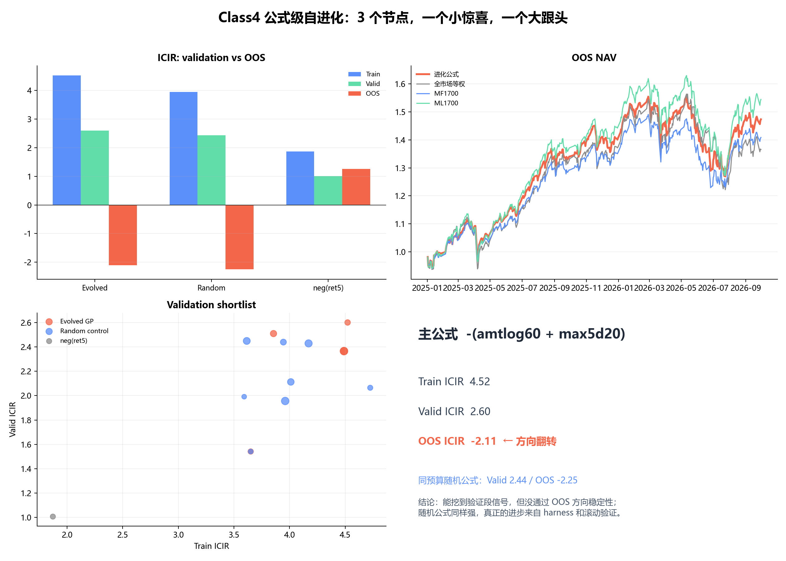

作业提交｜公式级自进化：3 个节点，一个小惊喜，一个大跟头

看了前面几位同学的 Harness 闭环和组合进化，我把搜索对象再往下沉了一层：**不选因子，直接进化公式树**。

实现放在 Class4 回测里：53 个因果时序基元 → 横截面 rank-z → GP 组合 `neg/abs/rank/z + add/sub/mul/div`，公式最多 9 个节点。训练 2021–2022、验证 2023–2024、OOS 2025–2026；写入 `freeze.json` 后才揭盲。进化 135 个公式，同时跑 135 个同预算随机公式做对照。

主公式只有 3 个节点：

```text
-(amtlog60 + max5d20)
```

- `amtlog60`：60 日平均成交额取 log
- `max5d20`：20 日内最强 5 日涨幅

结果很戏剧性：

```text
Train ICIR  4.52  →  Valid ICIR  2.60  →  OOS ICIR  -2.11
```

**验证段像模像样，OOS 直接方向翻转。** 同预算随机公式也一样：Valid ICIR 2.44 → OOS -2.25。`fastsim` 回测年化 25.82%、Sharpe 1.33，但 OOS IC 方向已经反了，我不把这个收益认作稳定 alpha。



我这轮最想分享的三个发现：

1. **公式级 GP 确实能在验证段找到信号**：3 节点公式的验证 ICIR 2.60，略高于随机公式 2.44；但差距不足以排除搜索噪声。
2. **OOS 方向稳定性比回测年化更重要**：公式和随机对照同时翻向，说明“验证段 IC 好看”远不等于可交易。
3. **下一步该进化的是 Harness，不是继续堆公式**：walk-forward、方向稳定性约束、公式级因果性投毒、换手/成本进入 fitness，这些比再挖几个高 IC 公式更有价值。

代码与完整报告：

- 代码：https://github.com/Mai-Xu/Class4_Backtest/tree/main/03_%E5%9B%A0%E5%AD%90%E6%8C%96%E6%8E%98/evo_formula
- 实验报告：https://github.com/Mai-Xu/Class4_Backtest/blob/main/out/03_%E5%9B%A0%E5%AD%90%E6%8C%96%E6%8E%98/evo_formula/train_formula_report.md
- OOS 一次性报告：https://github.com/Mai-Xu/Class4_Backtest/blob/main/out/03_%E5%9B%A0%E5%AD%90%E6%8C%96%E6%8E%98/evo_formula/oos_formula_report.md

一句话总结：**这次公式进化挖到的不是稳定因子，而是一条很重要的负结果——验证段有效、OOS 翻向，随机对照还很强。**
