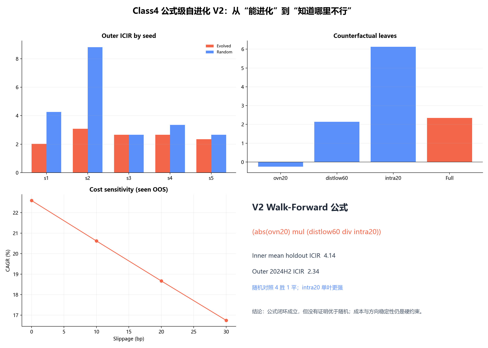

# 公式级 Walk-Forward V2

## 设计

- 5 个滚动训练/留出窗口，均只落在 2021–2023；
- 2024H2 作为一次 outer confirmation；
- 2025–2026 不在本实验中用于选择（V1 已消费，不能再次冒充盲测）；
- 每臂 59 个候选，进化 vs 同预算随机；
- fitness 同时考虑 holdout ICIR、最差 fold、方向一致性、节点数、换手成本代理。

## 五种子结果

| seed | evolved_fitness | random_fitness | evolved_outer_icir | random_outer_icir | evolved_outer_ic | random_outer_ic | evolved_nodes | random_nodes |
| --- | --- | --- | --- | --- | --- | --- | --- | --- |
| 20261030 | 2.3326537347236487 | 3.4081580226123673 | 2.0145104353533996 | 4.267386001614514 | 0.036860746896170034 | 0.04713739278745183 | 9 | 1 |
| 20261031 | 2.7954849217751367 | 3.4081580226123673 | 3.0760315576535833 | 8.817213780032578 | 0.07384509629588615 | 0.11979212301987063 | 8 | 1 |
| 20261032 | 3.0771321654355623 | 2.4021834746572432 | 2.6651234202149103 | 2.6651234202149103 | 0.06833622042688739 | 0.06833622042688739 | 8 | 4 |
| 20261033 | 3.114648613767935 | 3.5776188359554437 | 2.6532531182443995 | 3.357151709540325 | 0.03526361065727028 | 0.050059360828578786 | 4 | 9 |
| 20261034 | 3.225195911689982 | 2.8797068646529143 | 2.34124743426726 | 2.664436174845996 | 0.04433775404936765 | 0.03767723792620485 | 5 | 2 |

## 选中的冻结公式

`(abs(ovn20) mul (distlow60 div intra20))`

- inner mean holdout ICIR: 4.145
- inner min holdout ICIR: 2.327
- inner direction consistency: 1.00
- outer 2024H2 ICIR: 2.341
- outer turnover: 0.611

## 因果性/反事实

- 因果投毒检查：True（截断前后最大差见 `causal_audit.csv`）
- 池增量：{"formula_icir": 2.34124743426726, "baseline_icir": 2.742701453841539, "pool_icir": 3.6461947872024205, "pool_increment": 0.9034933333608817}
- 反事实拆解：`counterfactual.csv`

## 结论

如果五种子中随机臂仍经常赢，则公式级 GP 依然没有证明“搜索比同预算随机采样更好”；这次最多说明我们找到了一个可审计的公式搜索闭环，而不是 RSI。

## 实际审计结论（结果出来后追加）

- **随机臂 4 胜 1 平，进化臂未赢一场**：在 5 个种子的 outer 2024H2 ICIR 上，随机搜索为 4.27 / 8.82 / 2.67 / 3.36 / 2.66，进化臂为 2.01 / 3.08 / 2.67 / 2.65 / 2.34。
- **反事实拆解很关键**：完整公式 outer ICIR 为 2.34，但单独使用叶子 `intra20` 可达 6.12，`distlow60` 为 2.14，`ovn20` 为 −0.25。说明组合层把一个强单因子包坏了，复杂度惩罚还不够。
- **因果性通过**：3 个截断日期的 `max_abs_diff=0.0`，当前公式没有读取未来数据。
- **池增量为正**：相对 `neg(ret5)`，等权池 ICIR 从 2.74 提升到 3.65，增量约 0.90；但这是 2024H2 事后审计，不能再用于重新选公式。
- **成本暴露明显**：2025–2026 已经看过，仅作诊断；0→30bp 单边滑点时，年化约 22.6%→16.7%，夏普约 1.07→0.80，年化换手约 16.5x。

### 图表

### 失败台账

- `failure_taxonomy.csv`：保留全部进化候选的失败原因；
- `walkforward_trials.csv`：全部种子、全部候选、全部 fold 指标；
- `policy_memory.json`：把接受/拒绝证据转成下一轮算子权重和约束。

### 诚实结论

当前公式级 GP 已经具备：walk-forward、方向一致性、成本惩罚、同预算随机对照、因果投毒、反事实拆解和策略记忆。  
但它**仍没有证明自己优于同预算随机搜索**；这轮真正的成果，是找到一条可复现的失败路径和一组下一轮必须遵守的约束。
