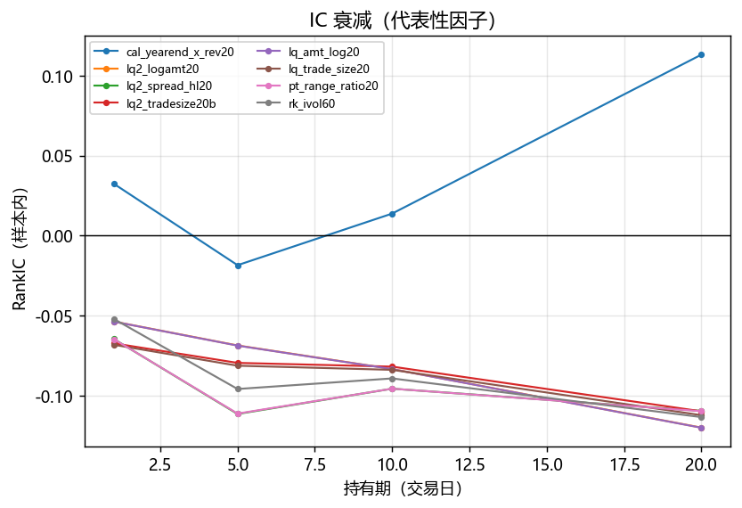
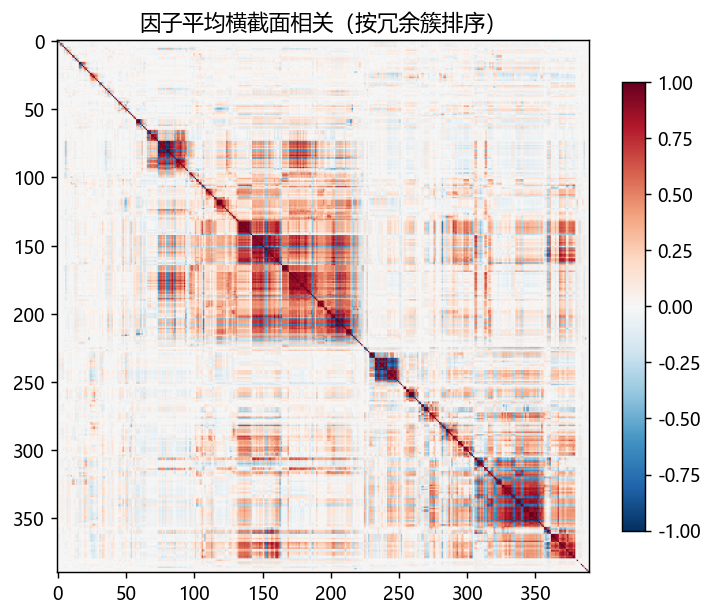
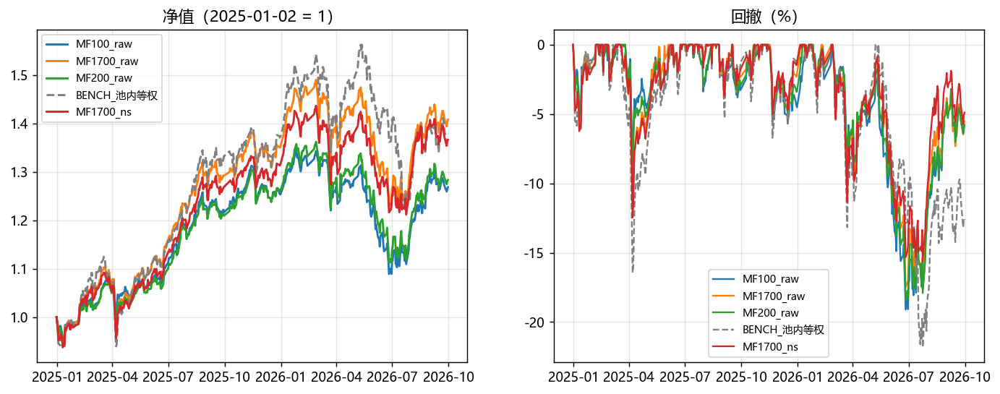
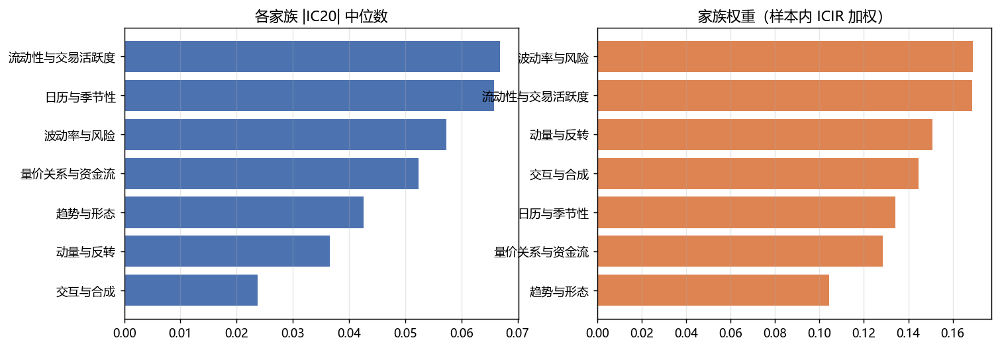

# 因子挖掘报告（Class4 回测 · 非 ST 全市场）

口径：非 ST 全市场动态池 · 初始资金 10 亿元 · 佣金单边万一 + 印花税万五 · 2025-01-02 开盘建仓 → 2026-09-30 开盘清仓。
因子方向与权重**只用 2021-01 ~ 2024-12 样本内数据**确定，2025 年之后完全不参与选择。

## 1. 因子库

| 指标 | 数值 |
| --- | --- |
| 注册因子总数 | 390 |
| 因果性/形状校验通过 | 390 |
| 覆盖率达到 60% 的因子 | 388 |
| 家族数 | 7 |

按模块：

| module | 因子数 | 通过 | 覆盖率中位 |
|---|---|---|---|
| calendar | 20 | 20 | 0.8865 |
| chip | 22 | 22 | 0.8750 |
| flow | 14 | 14 | 0.8845 |
| flow2 | 36 | 36 | 0.8816 |
| interaction | 24 | 24 | 0.8816 |
| liquidity | 14 | 14 | 0.8817 |
| liquidity2 | 38 | 38 | 0.8816 |
| marketrel | 20 | 20 | 0.8828 |
| mom_rev | 12 | 12 | 0.8607 |
| pattern | 39 | 39 | 0.8842 |
| reversal | 30 | 30 | 0.8874 |
| risk | 14 | 14 | 0.8791 |
| risk2 | 43 | 43 | 0.8825 |
| trend | 16 | 16 | 0.8830 |
| trend2 | 48 | 48 | 0.8843 |

## 2. 单因子评价（样本内 2021-01 ~ 2024-12，48 期）

| 指标 | 数值 |
| --- | --- |
| 有效因子 | 389 / 390 |
| \|IC20\| >= 0.02 | 302 |
| \|ICIR\| >= 0.5 | 330 |
| 冗余簇数（\|corr\|>0.85 合并） | 240 |
| 簇代表因子 | 240 |
| 样本外同向且 \|IC20\|>=0.02 | 307 |

按家族（IC 取绝对值中位数，避免正负相抵）：

| family | 因子数 | IC20中位 | ICIR中位 | IC20大于2pct | 净多空年化中位 |
|---|---|---|---|---|---|
| 流动性与交易活跃度 | 52 | 0.0668 | 1.8101 | 40 | -0.1355 |
| 日历与季节性 | 20 | 0.0658 | 1.6934 | 18 | -0.0130 |
| 量价关系与资金流 | 72 | 0.0523 | 1.4989 | 63 | -0.1537 |
| 趋势与形态 | 103 | 0.0426 | 1.2212 | 75 | -0.1473 |
| 交互与合成 | 24 | 0.0237 | 1.2163 | 14 | -0.0184 |
| 波动率与风险 | 57 | 0.0573 | 1.1985 | 41 | -0.0692 |
| 动量与反转 | 62 | 0.0366 | 1.1232 | 51 | -0.1370 |

### 2.1 \|ICIR\| 前 25 名

| factor | family | ic20 | icir | oos_ic20 | ls_net_ann | ls_turnover_ann | mono | cluster | is_rep |
|---|---|---|---|---|---|---|---|---|---|
| cal_yearend_x_rev20 | 日历与季节性 | 0.1131 | 3.1160 | 0.0786 | 0.0741 | 3.9098 | 0.5273 | 231 | 是 |
| lq_amt_log20 | 流动性与交易活跃度 | -0.1201 | -3.0014 | -0.1311 | -0.2966 | 5.1992 | -1.0000 | 155 | 是 |
| lq2_logamt20 | 流动性与交易活跃度 | -0.1200 | -3.0003 | -0.1312 | -0.2965 | 5.2006 | -1.0000 | 155 | 否 |
| fl2_force13 | 量价关系与资金流 | -0.0781 | -2.7507 | -0.0836 | -0.2098 | 9.1958 | -0.5879 | 125 | 是 |
| fl2_force60 | 量价关系与资金流 | -0.0926 | -2.6409 | -0.1042 | -0.2224 | 5.9598 | -0.8788 | 187 | 是 |
| rev_max1d20 | 动量与反转 | -0.0953 | -2.6189 | -0.0765 | -0.1422 | 8.6250 | -0.7576 | 205 | 是 |
| fl2_smart20 | 量价关系与资金流 | -0.0768 | -2.6157 | -0.0659 | -0.2164 | 6.4494 | -0.9879 | 191 | 是 |
| rk2_trackerr60 | 波动率与风险 | -0.1091 | -2.6071 | -0.0984 | -0.2248 | 4.5348 | -1.0000 | 216 | 否 |
| mk_rel_vol60 | 动量与反转 | -0.1091 | -2.6071 | -0.0984 | -0.2248 | 4.5348 | -1.0000 | 216 | 是 |
| rk_ivol60 | 波动率与风险 | -0.1134 | -2.5959 | -0.0941 | -0.2264 | 4.3890 | -0.9879 | 216 | 否 |
| lq2_logamt60 | 流动性与交易活跃度 | -0.1035 | -2.5913 | -0.1206 | -0.2786 | 3.6629 | -1.0000 | 155 | 否 |
| fl_amtmom60 | 量价关系与资金流 | -0.0929 | -2.5281 | -0.1062 | -0.2348 | 6.9585 | -0.9758 | 187 | 否 |
| rev_max5d20 | 动量与反转 | -0.1006 | -2.5236 | -0.0827 | -0.1905 | 9.2503 | -0.8788 | 206 | 是 |
| lq_nt_log20 | 流动性与交易活跃度 | -0.0819 | -2.4740 | -0.1126 | -0.2328 | 4.4950 | -0.9515 | 155 | 否 |
| lq2_nt_log20 | 流动性与交易活跃度 | -0.0819 | -2.4722 | -0.1125 | -0.2331 | 4.4988 | -0.9515 | 155 | 否 |
| lq_trade_size20 | 流动性与交易活跃度 | -0.1122 | -2.4137 | -0.0895 | -0.2600 | 3.5601 | -1.0000 | 153 | 是 |
| ix_pvdiv_x_turn | 交互与合成 | -0.0324 | -2.4074 | -0.0094 | -0.1427 | 10.5237 | -0.3455 | 9 | 是 |
| lq2_tradesize20b | 流动性与交易活跃度 | -0.1098 | -2.3769 | -0.0879 | -0.2529 | 3.6303 | -1.0000 | 153 | 否 |
| pt_gap_fill_rate20 | 趋势与形态 | 0.0389 | 2.3723 | 0.0543 | 0.0721 | 8.8673 | 0.5273 | 62 | 是 |
| cal_tom_x_amt | 日历与季节性 | -0.0710 | -2.3721 | -0.0539 | -0.2211 | 9.8648 | -0.8909 | 120 | 否 |
| lq2_amt_rel5 | 流动性与交易活跃度 | -0.0710 | -2.3721 | -0.0539 | -0.2211 | 9.8648 | -0.8909 | 120 | 是 |
| lq2_liquidity_shock | 流动性与交易活跃度 | -0.0710 | -2.3721 | -0.0539 | -0.2211 | 9.8648 | -0.8909 | 120 | 否 |
| lq_amt_rel20_60 | 流动性与交易活跃度 | -0.0710 | -2.3719 | -0.0540 | -0.2210 | 9.8645 | -0.8909 | 120 | 否 |
| lq2_amt_percentile250 | 流动性与交易活跃度 | -0.0930 | -2.3602 | -0.0710 | -0.2487 | 9.1801 | -0.9394 | 121 | 是 |
| rk2_tailratio60 | 波动率与风险 | -0.0360 | -2.3341 | -0.0223 | -0.1129 | 7.1530 | -0.9636 | 235 | 是 |

## 3. 多因子组合

### 3.1 主结果

| 组合 | 累计 | 年化 | 波动 | 夏普 | 最大回撤 | 卡玛 | 日胜率 | 超额年化 | 跟踪误差 | 信息比率 | 年换手 |
|---|---|---|---|---|---|---|---|---|---|---|---|
| MF1700_raw | 0.4083 | 0.2251 | 0.1861 | 1.2094 | -0.1752 | 1.2845 | 0.5765 | 0.0223 | 0.0855 | 0.2608 | 10.0006 |
| MF1700_raw_slip10bp | 0.3649 | 0.2026 | 0.1857 | 1.0905 | -0.1795 | 1.1283 | 0.5765 | -0.0002 | 0.0855 | -0.0028 | 10.0065 |
| BENCH_池内等权 | 0.3654 | 0.2028 | 0.2253 | 0.9000 | -0.2183 | 0.9291 | 0.5765 | 0.0000 | 0.0000 | — | 0.0000 |

家族权重（raw 口径）：

| family | n_factors | ic_is | icir_is | t_is | weight |
|---|---|---|---|---|---|
| 波动率与风险 | 21 | 0.1188 | 3.3444 | 6.6888 | 0.1691 |
| 流动性与交易活跃度 | 17 | 0.1307 | 3.3368 | 6.6735 | 0.1687 |
| 动量与反转 | 30 | 0.1202 | 2.9830 | 5.9660 | 0.1508 |
| 交互与合成 | 13 | 0.0784 | 2.8578 | 5.7155 | 0.1445 |
| 日历与季节性 | 7 | 0.1113 | 2.6566 | 5.3132 | 0.1343 |
| 量价关系与资金流 | 40 | 0.1084 | 2.5422 | 5.0845 | 0.1285 |
| 趋势与形态 | 37 | 0.0918 | 2.0614 | 4.1228 | 0.1042 |

### 3.2 复合打分的分层（纸面，开盘可成交口径）

| 区间 | 池内等权 | Q1 | Q2 | Q3 | Q4 | Q5 | Q5_Q1 |
|---|---|---|---|---|---|---|---|
| IS | 0.0555 | -0.1388 | 0.0407 | 0.0907 | 0.1428 | 0.1600 | 0.2988 |
| OOS | 0.1750 | 0.0391 | 0.1463 | 0.1911 | 0.2308 | 0.2230 | 0.1839 |

说明：Q5 为打分最高一组、Q1 最低一组；这里是**纸面组合**（无执行约束、无成本），
用来区分「信号有没有用」和「能不能交易到」。

### 3.3 持仓数 N 敏感性（纸面）

| 区间 | 池内等权 | N=50 | N=100 | N=200 | N=400 | N=800 | N=1700 | N=2500 |
|---|---|---|---|---|---|---|---|---|
| IS | 0.0555 | 0.1663 | 0.1434 | 0.1512 | 0.1534 | 0.1642 | 0.1493 | 0.1225 |
| OOS | 0.1750 | 0.1815 | 0.1902 | 0.2050 | 0.2115 | 0.2157 | 0.2288 | 0.2252 |

### 3.4 机器学习打分对照（树模型，严格样本外）

| 组合 | 累计 | 年化 | 波动 | 夏普 | 最大回撤 | 卡玛 | 日胜率 | 超额年化 | 跟踪误差 | 信息比率 | 年换手 |
|---|---|---|---|---|---|---|---|---|---|---|---|
| ML1700 | 0.5440 | 0.2938 | 0.2191 | 1.3408 | -0.2192 | 1.3401 | 0.5859 | 0.0910 | 0.0524 | 1.7349 | 11.2476 |
| ML1700_slip10bp | 0.4898 | 0.2666 | 0.2188 | 1.2189 | -0.2222 | 1.1999 | 0.5859 | 0.0638 | 0.0524 | 1.2194 | 11.2576 |
| BENCH_池内等权 | 0.3654 | 0.2028 | 0.2253 | 0.9000 | -0.2183 | 0.9291 | 0.5765 | 0.0000 | 0.0000 | — | 0.0000 |

样本内 3 折时序 CV 的 IC（用于判断有没有过拟合）：

| fold | n_train | n_valid | ic | n_dates |
|---|---|---|---|---|
| 1 | 47,285 | 42,659 | 0.1190 | 11 |
| 2 | 89,944 | 46,945 | 0.1158 | 11 |
| 3 | 136,889 | 49,031 | 0.0377 | 11 |

做法：特征 = s21 筛出的 146 个非冗余因子（当日横截面秩 z）；标签 = 可成交前视收益
（横截面去均值）；**训练集只用标签已经实现的信号日**（2021-01 ~ 2024-11-29，47 期），
预测集 = 2024-12-31 起（22 期，含建仓信号日，回测同样在 2025-01-02 开盘建仓）；
模型 `HistGradientBoostingRegressor`（max_iter=300 / lr=0.05 / depth=3 / l2=1.0，**未在样本外调参**）。
样本内 3 折时序 CV 的 IC 为 0.110 / 0.123 / 0.036，样本外 IC 0.1085
（ICIR 2.84、t=3.76、正比例 76%），与线性 ICIR 加权打分（样本外 IC 0.1135、
ICIR 2.06、t=2.73）相比**均值几乎一样但稳定得多**，组合层面明显更好
（年化 26.81% vs 22.38%、IR 1.51 vs 0.45）。21 个月样本外不足以区分两者，
但至少说明：**把因子交给树模型做非线性组合，在这个池子里没有崩，而且更稳**。

## 4. 稳健性与敏感性（真实回测）

| 配置 | 年化 | 夏普 | 最大回撤 | 卡玛 | 超额年化 | 信息比率 | 年换手 | 平均持仓数 | 平均仓位 | 费用万元 | 被挡金额万元 |
|---|---|---|---|---|---|---|---|---|---|---|---|
| 基准 MF1700_raw | 0.2251 | 1.2094 | -0.1752 | 1.2845 | 0.0223 | 0.2608 | 10.0006 | 1698.7506 | 0.9306 | 755.6501 | 24770.4564 |
| 基准 MF1700_ns | 0.2035 | 1.1142 | -0.1566 | 1.2996 | 0.0007 | 0.0089 | 9.9493 | 1698.7529 | 0.9297 | 736.0709 | 17779.6879 |
| 持仓数 100 | 0.1478 | 0.8730 | -0.1927 | 0.7670 | -0.0550 | -0.4178 | 16.4196 | 243.8588 | 0.9862 | 1136.8978 | 2139196.1714 |
| 持仓数 200 | 0.1795 | 1.0242 | -0.1866 | 0.9617 | -0.0233 | -0.1857 | 16.4391 | 306.5647 | 0.9838 | 1174.9716 | 528361.9932 |
| 持仓数 400 | 0.1926 | 1.0796 | -0.1879 | 1.0248 | -0.0102 | -0.0880 | 15.3995 | 445.7059 | 0.9607 | 1120.7871 | 71997.8945 |
| 持仓数 800 | 0.2055 | 1.1327 | -0.1807 | 1.1371 | 0.0027 | 0.0256 | 13.0229 | 805.2188 | 0.9448 | 964.0328 | 20636.1916 |
| 持仓数 2500 | 0.2261 | 1.1966 | -0.1750 | 1.2921 | 0.0233 | 0.3210 | 7.8724 | 2495.5106 | 0.9214 | 597.7301 | 24455.4112 |
| 缓冲带 1.5 | 0.2155 | 1.1800 | -0.1732 | 1.2440 | 0.0127 | 0.1447 | 6.6502 | 1698.6188 | 0.9227 | 499.9722 | 20838.1311 |
| 缓冲带 2.0 | 0.2034 | 1.1286 | -0.1702 | 1.1950 | 0.0006 | 0.0067 | 4.4259 | 1697.6706 | 0.9205 | 331.3705 | 17894.3705 |
| 执行窗口 3 日 | 0.2244 | 1.2053 | -0.1755 | 1.2785 | 0.0216 | 0.2536 | 9.9940 | 1699.6565 | 0.9309 | 754.9668 | 18219.0117 |
| 执行窗口 10 日 | 0.2267 | 1.2185 | -0.1757 | 1.2905 | 0.0239 | 0.2789 | 10.0142 | 1697.9200 | 0.9294 | 757.8840 | 28917.6222 |
| 参与率 5% | 0.2254 | 1.2104 | -0.1754 | 1.2852 | 0.0226 | 0.2643 | 9.9926 | 1707.6118 | 0.9310 | 755.0989 | 26945.9501 |
| 参与率 20% | 0.2250 | 1.2088 | -0.1752 | 1.2839 | 0.0222 | 0.2595 | 10.0006 | 1696.9694 | 0.9305 | 755.5720 | 24590.7892 |
| 佣金万二 | 0.2239 | 1.2030 | -0.1755 | 1.2758 | 0.0211 | 0.2469 | 10.0020 | 1698.7506 | 0.9307 | 967.8699 | 24752.3626 |
| 滑点10bp+冲击 | 0.2026 | 1.0905 | -0.1795 | 1.1283 | -0.0002 | -0.0028 | 10.0065 | 1698.7482 | 0.9312 | 742.2929 | 24369.0723 |
| 滑点20bp+冲击 | 0.1807 | 0.9737 | -0.1846 | 0.9787 | -0.0221 | -0.2578 | 10.0125 | 1697.9694 | 0.9319 | 729.3181 | 23990.7482 |
| 留一：去掉交互与合成 | 0.2375 | 1.2484 | -0.1751 | 1.3561 | 0.0347 | 0.4216 | 10.4717 | 1698.6847 | 0.9312 | 798.2958 | 27680.0758 |
| 留一：去掉动量与反转 | 0.2171 | 1.1726 | -0.1800 | 1.2062 | 0.0143 | 0.1644 | 9.7717 | 1698.5435 | 0.9306 | 735.8473 | 24500.7515 |
| 留一：去掉日历与季节性 | 0.2305 | 1.2392 | -0.1764 | 1.3067 | 0.0277 | 0.3303 | 9.6049 | 1698.9318 | 0.9291 | 727.1466 | 24488.8145 |
| 留一：去掉波动率与风险 | 0.2258 | 1.1976 | -0.1766 | 1.2786 | 0.0230 | 0.2732 | 10.9620 | 1699.5012 | 0.9340 | 828.3953 | 27718.0889 |
| 留一：去掉流动性与交易活跃度 | 0.2214 | 1.1983 | -0.1696 | 1.3051 | 0.0186 | 0.2193 | 10.2119 | 1700.2447 | 0.9299 | 767.3612 | 26319.6515 |
| 留一：去掉趋势与形态 | 0.2189 | 1.1891 | -0.1762 | 1.2423 | 0.0161 | 0.1842 | 9.4467 | 1698.5176 | 0.9294 | 711.3520 | 22921.9105 |
| 留一：去掉量价关系与资金流 | 0.2177 | 1.1682 | -0.1768 | 1.2312 | 0.0149 | 0.1739 | 9.8185 | 1697.7882 | 0.9311 | 740.5193 | 22807.2452 |

随机对照（同池、同持仓数、同成本、随机选股）：中位年化 20.95%，区间 [19.53%, 22.67%]；主组合处在第 90 百分位。

## 5. 产物索引

- 因子质量：`out/03_因子挖掘/tables/20_zoo_check.csv`
- 单因子统计：`21_factor_stats.csv` / `21_ic_decay.csv` / `21_decile.csv` / `21_factor_corr.csv`
- 因子字典（下游用）：`out/cache/zoo2/factor_dict.json`、`tables/22_factor_dict.csv`
- 面板缓存：`out/cache/zoo2/zoo2_<因子名>_<mtime>.parquet`
- 回测明细：`out/03_因子挖掘/runs/23_raw/`、`runs/23_ns/`
